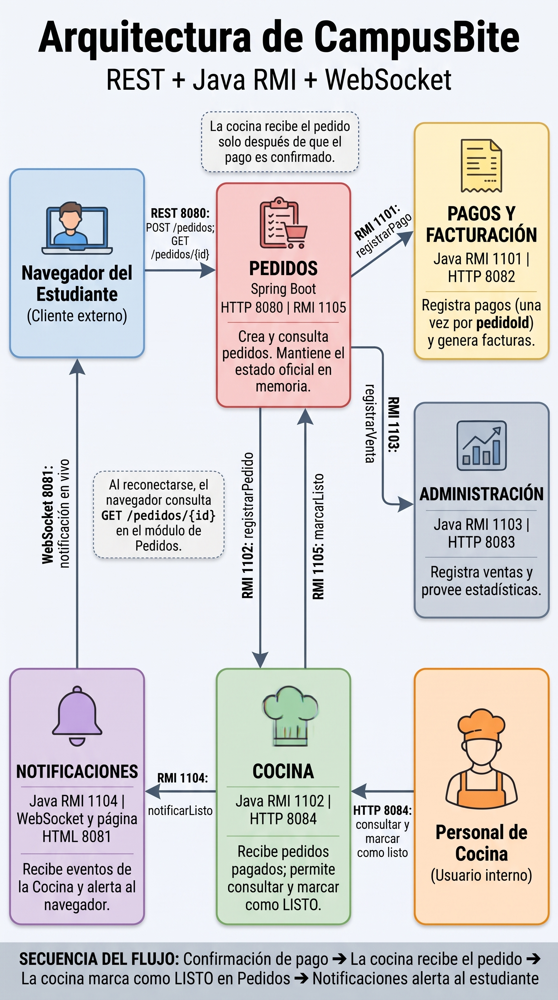
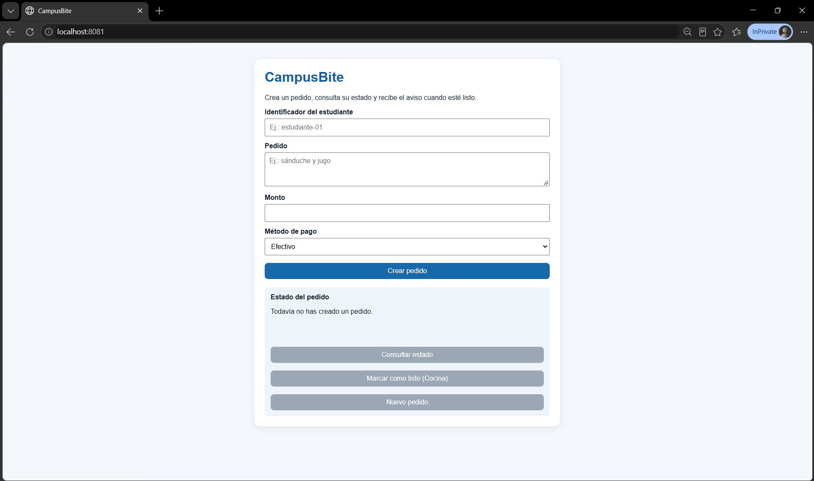
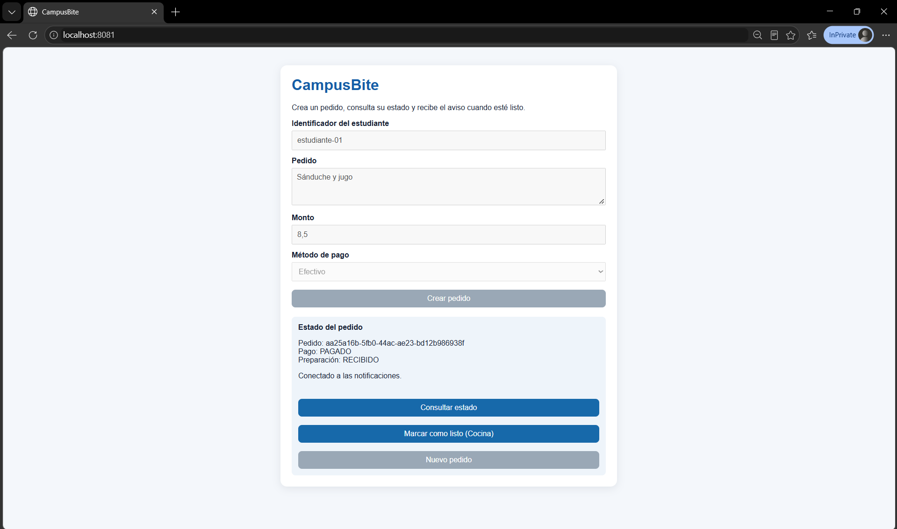
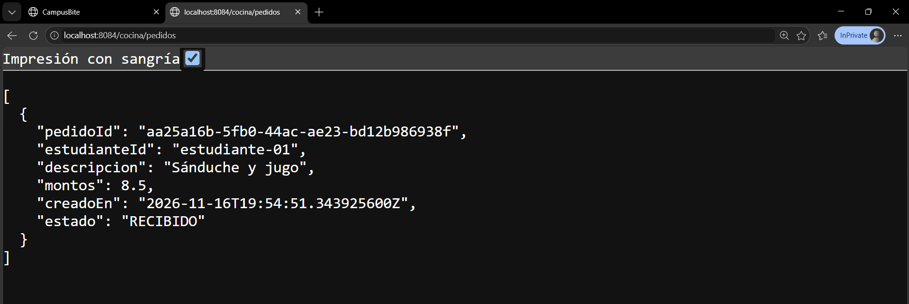
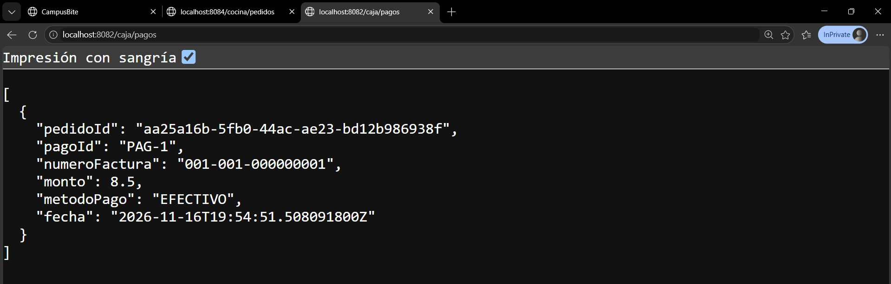
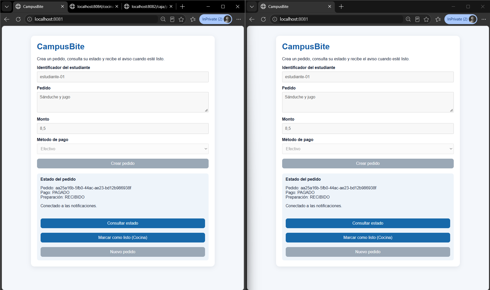
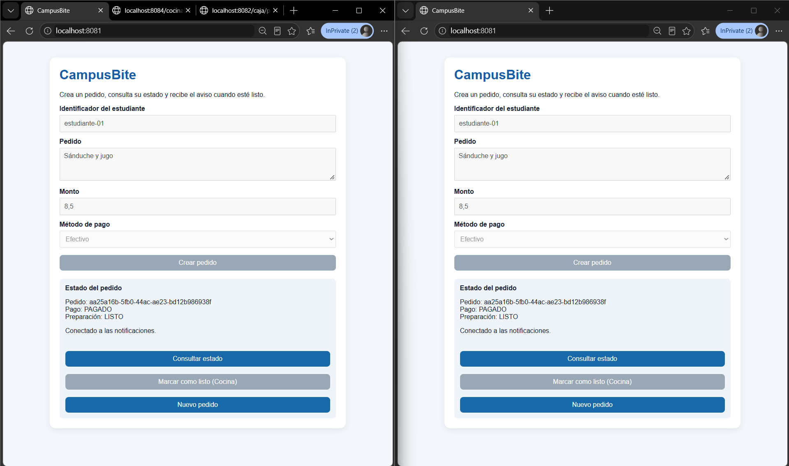
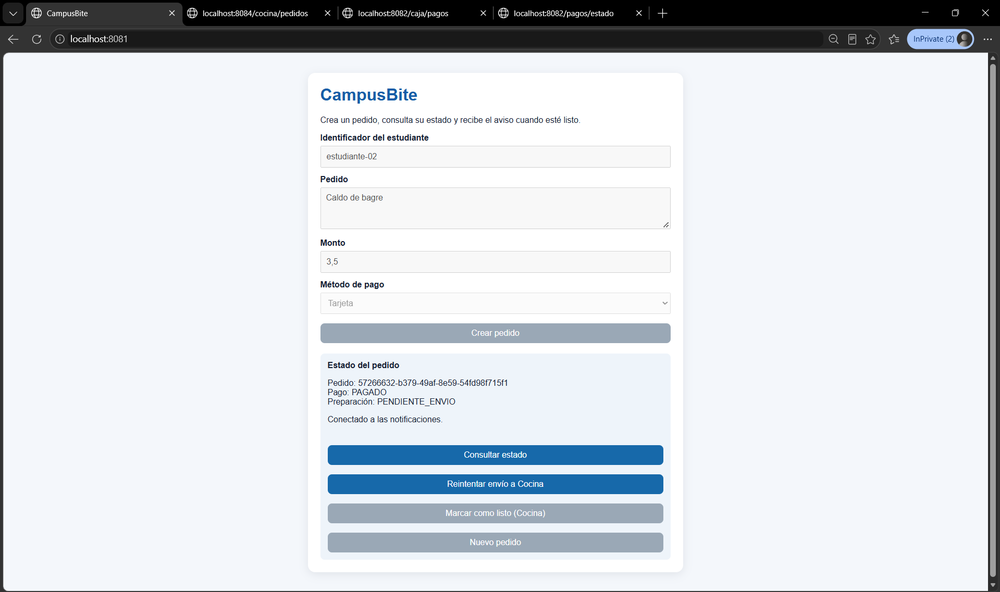
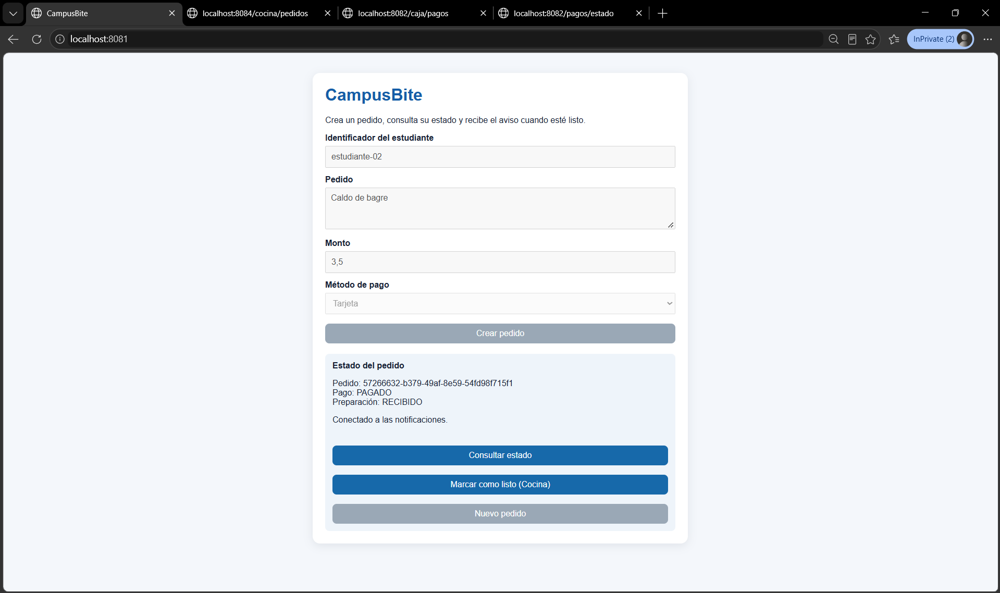
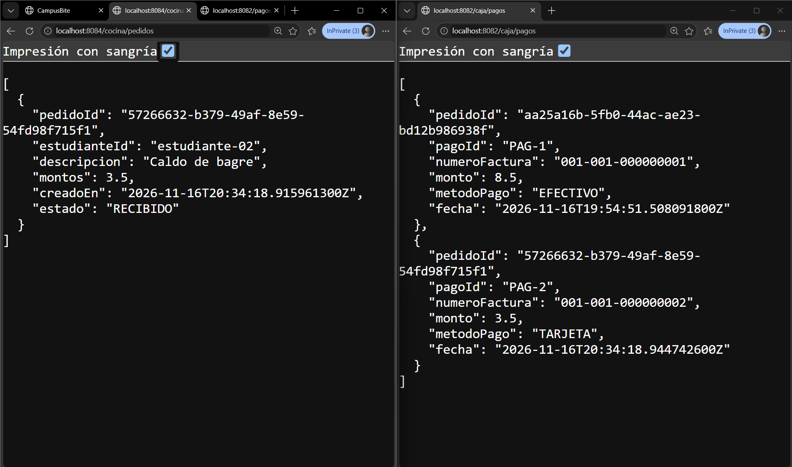

# Sistemas Distribuidos


# Sistema distribuido de pedidos para la cafetería del campus

<div align="center">
  
  
  
</div>

## Práctica: Mecanismos de comunicación en sistemas distribuidos

## Autores

**Carlos Antonio Gordillo Tenemaza**
* 📧 Correo: [cgordillot@est.ups.edu.ec](mailto:cgordillot@est.ups.edu.ec)
* 💻 GitHub: [antonikr8s](https://github.com/antonikr8s)

**John Ismael Tigre Cuji**
* 📧 Correo: [jtigrec4@est.ups.edu.ec](mailto:jtigrec4@est.ups.edu.ec)
* 💻 GitHub: [tigresitop](https://github.com/tigresitop)

**David Esteban Sisa Buestan**
* 📧 Correo: [dsisab@est.ups.edu.ec](mailto:dsisab@est.ups.edu.ec)
* 💻 GitHub: [Riiiiii1](https://github.com/Riiiiii1)

---

## Descripción

CampusBite es un sistema distribuido para gestionar pedidos de la cafetería del campus. El estudiante crea un pedido desde una página web, consulta su estado y recibe un aviso cuando Cocina lo marca como listo.

El proyecto separa las responsabilidades en cinco servicios Java. Para comunicarse utiliza REST, Java RMI y WebSocket. En esta práctica, los pedidos, pagos y ventas se mantienen en memoria mientras los servicios están ejecutándose.

## Tecnologías y mecanismos de comunicación

| Tecnología | Uso en CampusBite |
|---|---|
| Java 17 | Lenguaje de los cinco servicios |
| Spring Boot | API REST de Pedidos |
| Java RMI | Comunicación entre los servicios |
| WebSocket | Aviso en vivo al navegador del estudiante |
| HTML y JavaScript | Página para crear pedidos y consultar su estado |
| Maven Wrapper | Compilación del proyecto |

## Servicios del sistema

| Servicio | Responsable | Función | Puertos |
|---|---|---|---|
| Pedidos | David | Recibe los pedidos por REST, coordina los demás servicios y conserva el estado oficial del pedido | HTTP 8080; RMI 1105 para la actualización desde Cocina |
| Pagos y Facturación | John | Registra el pago de forma idempotente y genera el comprobante y la factura | RMI 1101; HTTP 8082 para consultas |
| Administración | John | Registra ventas y permite consultar estadísticas | RMI 1103; HTTP 8083 para consultas |
| Cocina | Carlos | Recibe los pedidos pagados, permite consultarlos y marcarlos como listos | RMI 1102; HTTP 8084 |
| Notificaciones | Carlos | Recibe el evento de Cocina y avisa al navegador | RMI 1104; página HTML y WebSocket en 8081 |

## Cómo funciona un pedido

1. El estudiante crea el pedido desde la página web. La página envía `POST /pedidos` al servicio Pedidos.
2. Pedidos solicita el cobro a Pagos. Pagos registra el pago y genera el comprobante y la factura.
3. Si el pago se confirma, Pedidos intenta registrar la venta en Administración y después envía el pedido a Cocina. Si Administración no responde, la venta queda pendiente para reintentar.
4. Cuando el personal de Cocina termina la preparación, Cocina marca el pedido como `LISTO` en Pedidos.
5. Después, Cocina envía el evento a Notificaciones para avisar al navegador mediante WebSocket.
6. Si el estudiante estaba desconectado, al volver la página consulta `GET /pedidos/{id}` y recupera el estado desde Pedidos.

Si Pagos no responde, el pedido puede quedar `PENDIENTE_PAGO` y Cocina no lo recibe. El procesamiento puede reintentarse sin crear otro cobro para el mismo pedido.

## Arquitectura

La siguiente imagen muestra los cinco servicios y las comunicaciones `REST`, `RMI` y `WebSocket` del proyecto.



El contexto del sistema, los escenarios de calidad y el mapa de comunicación están en [Arquitectura de CampusBite](docs/ARQUITECTURA.md).

Pedidos conserva el estado oficial mientras su proceso está ejecutándose. Por eso Cocina actualiza primero a Pedidos y después envía el aviso a Notificaciones.

## Requisitos y ejecución local

Se necesita **JDK 17** y una terminal con PowerShell o IntelliJ IDEA. El proyecto incluye Maven Wrapper, por lo que se puede compilar desde la carpeta raíz con:

```powershell
.\mvnw.cmd -DskipTests compile
```

Si Maven indica que `JAVA_HOME` no está configurado, hay que establecerlo con la ruta del JDK 17 instalado en el equipo antes de ejecutar el comando.

Para probar el flujo completo, inicia estos cinco procesos **por separado** en IntelliJ IDEA:

1. `PagosMain`
2. `AdministracionMain`
3. `NotificacionesMain`
4. `CocinaMain`
5. `CampusBiteSisaDGordilloCTigreJApplication` (Pedidos)

La integración con Cocina requiere `campusbite.cocina.habilitada=true` en la configuración de Pedidos. Después de cambiar esa propiedad, reinicia Pedidos.

Con los servicios levantados, abre la página del estudiante en `http://localhost:8081`.

## Direcciones útiles para comprobar el sistema

| Dirección | Qué permite consultar |
|---|---|
| `http://localhost:8081` | Página para crear y seguir un pedido |
| `http://localhost:8084/cocina/pedidos` | Pedidos recibidos en Cocina |
| `http://localhost:8082/caja/pagos` | Pagos registrados |
| `http://localhost:8082/pagos/estado` | Muestra el valor de `retrasoMs` en Pagos |
| `http://localhost:8083/admin/estadisticas` | Muestra las estadísticas de ventas |
| `http://localhost:8083/admin/ventas` | Muestra las ventas registradas |

Para consultar un pedido concreto en Pedidos, usa `http://localhost:8080/pedidos/{id}` y reemplaza `{id}` por el identificador real.

## Pruebas y documentación

Las pruebas del proyecto cubren solicitudes duplicadas, fallas de servicios, avisos en vivo y desconexión del estudiante.

| Escenario | Qué se comprobó | Documentación |
|---|---|---|
| REST | Veinte solicitudes con la misma clave conservaron un pedido, un pago y una venta. También se comprobaron las respuestas para solicitudes repetidas e inválidas. | [Procedimiento REST](docs/REST_PROCEDIMIENTO.md) y [reporte de Maven](docs/evidencias/REST_integracion_pedidos.txt) |
| E1 | Un mismo pedido no produce cobros, facturas o ventas duplicadas | [Evidencias E1](docs/evidencias/) |
| E2 | El timeout o la caída de Pagos permite consultar y reintentar sin cobrar dos veces | [Procedimiento E2](docs/E2_PROCEDIMIENTO.md) |
| E3 | Un navegador conectado muestra `LISTO` sin consultar manualmente | [Procedimiento E3 y E4](docs/E3_E4_PROCEDIMIENTO.md) y [captura E3](docs/evidencias/E3_aviso_en_tiempo_real.png) |
| E4 | Tras desconectarse, el estudiante recupera `LISTO` al volver | [Procedimiento E3 y E4](docs/E3_E4_PROCEDIMIENTO.md) y [evidencias E4](docs/evidencias/) |

También se encuentran en `docs/` las decisiones de arquitectura, la documentación de Pagos y Administración y las bitácoras de IA de los tres integrantes.

## Capturas del funcionamiento

Para las capturas 01 a 05 se utilizó el pedido `aa25a16b-5fb0-44ac-ae23-bd12b986938f`, creado por `estudiante-01` con la descripción «Sánduche y jugo» y un monto de `8,5`.

### Página del estudiante

La página permite ingresar los datos del pedido y consultar su estado.



### Pedido recibido

Después de crear el pedido, la página mostró el pago como `PAGADO` y la preparación como `RECIBIDO`.



### Pedido en Cocina

Cocina recibió el mismo `pedidoId` con estado `RECIBIDO`.



### Pago y factura

Caja registró el pago `PAG-1` y el número de factura `001-001-000000001` para ese mismo pedido.



### Aviso en vivo

Primero, las dos ventanas mostraban el pedido como `RECIBIDO`.



Luego se pulsó «Marcar como listo (Cocina)» en la ventana izquierda. La ventana derecha se actualizó a `LISTO` sin pulsar ningún botón en ella.



### Reintento de envío a Cocina

Para esta prueba se detuvo `CocinaMain` y se creó el pedido `57266632-b379-49af-8e59-54fd98f715f1` de `estudiante-02`: «Caldo de bagre», por `3,5`, con Tarjeta. El pago quedó como `PAGADO`, pero la preparación mostró `PENDIENTE_ENVIO` porque Cocina no estaba ejecutándose.



Después se inició `CocinaMain` y se pulsó una sola vez «Reintentar envío a Cocina». El mismo pedido cambió a `RECIBIDO`.



Al consultar Cocina, el pedido apareció una sola vez. Caja mostró un solo pago para ese `pedidoId`: `PAG-2`, con la factura `001-001-000000002`. El otro pago que aparece en la captura, `PAG-1`, corresponde a un pedido anterior.



