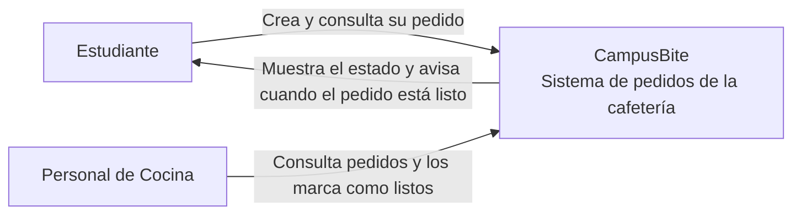
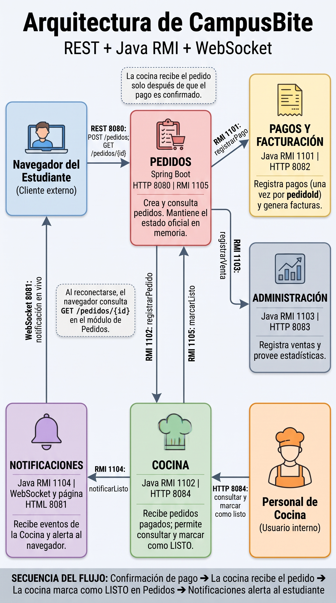

# Arquitectura de CampusBite

## Contexto del sistema (C4, nivel 1)

CampusBite permite al estudiante crear un pedido, consultar su estado y recibir un aviso cuando está listo. El personal de Cocina consulta los pedidos recibidos y los marca como listos.

## Escenarios de calidad priorizados

La prioridad sigue el efecto que tendría cada problema sobre el pedido: primero evitar duplicados y manejar fallas de los servicios; después, asegurar que el estudiante vea el estado correcto.

| Prioridad | Situación | Respuesta que debe dar CampusBite |
|---|---|---|
| 1 | Se envía otra vez el mismo pedido con la misma `Idempotency-Key`. | Pedidos conserva el mismo pedido. No se generan otro cobro, otra factura ni otra venta. |
| 2 | Pagos tarda en responder o está apagado. | Pedidos responde sin quedarse esperando indefinidamente. El pedido puede consultarse y reintentarse sin cobrarlo dos veces. |
| 3 | Cocina está apagada cuando Pedidos intenta enviarle un pedido pagado. | El pedido queda en `PENDIENTE_ENVIO`. Cuando Cocina vuelve a funcionar, se puede reintentar y pasa a `RECIBIDO` sin duplicarse. |
| 4 | El estudiante cierra la página antes de que su pedido esté listo. | Al volver a abrirla, la página consulta el estado en Pedidos y muestra `LISTO`, aunque no haya recibido el aviso WebSocket. |
| 5 | El estudiante mantiene la página abierta mientras Cocina marca el pedido como listo. | La página muestra `LISTO` sin que el estudiante pulse «Consultar estado». |

## Mapa de servicios y comunicación

CampusBite ejecuta cinco servicios por separado: Pedidos, Pagos y Facturación, Administración, Cocina y Notificaciones. Esta imagen muestra cómo se comunican:

| Origen → destino | Mecanismo y puerto | Tipo | Qué hace |
|---|---|---|---|
| Navegador → Notificaciones | HTTP 8081 | Síncrona | Carga la página del estudiante. |
| Navegador → Pedidos | REST 8080 | Síncrona | Crea, consulta o reintenta un pedido. |
| Pedidos → Pagos y Facturación | RMI 1101 | Síncrona | Solicita el pago y recibe el comprobante. |
| Pedidos → Administración | RMI 1103 | Síncrona | Intenta registrar la venta. |
| Pedidos → Cocina | RMI 1102 | Síncrona | Envía el pedido después de confirmar el pago. |
| Navegador → Cocina | HTTP 8084 | Síncrona | Consulta pedidos o marca uno como listo desde la página. |
| Cocina → Pedidos | RMI 1105 | Síncrona | Actualiza primero el estado del pedido a `LISTO`. |
| Cocina → Notificaciones | RMI 1104 | Síncrona | Envía el evento después de actualizar Pedidos. |
| Notificaciones → navegador | WebSocket 8081 | Asíncrona | Avisa que el pedido está listo mientras la página está abierta. |

Pagos también tiene consultas HTTP en el puerto 8082 y Administración en el 8083. Sus direcciones están en el README.

Las llamadas REST y RMI esperan una respuesta. El aviso WebSocket llega después como mensaje al navegador. Si el navegador estaba desconectado, al volver consulta `GET /pedidos/{id}` en Pedidos.
